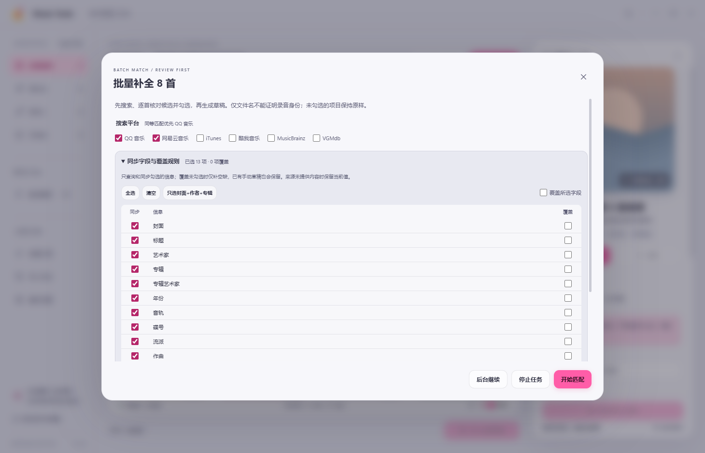

<p align="center"></p>

<h1 align="center">Music Tools</h1>

<p align="center"><strong>让每一首本地音乐，都有完整的归属。</strong></p>
<p align="center">标签编辑 · 六来源补全 · 封面管理 · 双语歌词导出 · 批量整理</p>
<p align="center">Windows x64 · v1.0.0 首次发布 · GPL-3.0-or-later</p>

<p align="center"><a href="https://github.com/GXinnnnnn/Music-Tools/releases/tag/v1.0.0">下载 1.0.0</a> · <a href="docs/lyrics.md">歌词使用说明</a> · <a href="docs/providers.md">在线来源说明</a> · <a href="docs/text-tools.md">文本工具说明</a> · <a href="https://github.com/GXinnnnnn/Music-Tools/issues">反馈问题</a></p>

Music Tools 是一款面向本地音乐收藏的 Windows 桌面整理工具。用大封面网格浏览音乐，在常驻详情栏编辑属性，从六个在线来源寻找封面与资料，核对候选后保存草稿，再统一写入。歌词工作台支持 QQ 音乐与网易云音乐，可预览、编辑原文和译文，并导出 SRT、LRC 或 TXT。


## 下载与运行

1.0.0 提供以下三个下载文件，运行版均自带所需环境，无需安装 Node.js 或 Python。

| 下载 | 适合用途 |
| --- | --- |
| [Music-Tools-1.0.0-Setup-x64.exe](https://github.com/GXinnnnnn/Music-Tools/releases/download/v1.0.0/Music-Tools-1.0.0-Setup-x64.exe) | 安装版：可选择安装目录，提供快捷方式与卸载入口 |
| [Music-Tools-1.0.0-Portable-x64.zip](https://github.com/GXinnnnnn/Music-Tools/releases/download/v1.0.0/Music-Tools-1.0.0-Portable-x64.zip) | 便携版：解压到可写位置，运行文件夹中的 `Music Tools.exe` |
| [Music-Tools-1.0.0-Source.zip](https://github.com/GXinnnnnn/Music-Tools/releases/download/v1.0.0/Music-Tools-1.0.0-Source.zip) | 源码包：用于开发与自行构建 |

便携版请保留**整个解压文件夹**，不要单独移动 EXE；配置、工作区和备份保存在程序旁的 `data/`。安装版将这些数据保存在当前用户的应用数据目录 `%APPDATA%\Music Tools`。完整文件备份需要相应的磁盘空间。

## 从一首歌开始

1. 添加音频、导入文件夹，或把文件和文件夹拖入窗口。空队列也可加载内置演示音频体验功能。
2. 单击封面，在右侧详情栏查看和编辑；按住 `Ctrl` 多选，或使用 `Shift` 连选。
3. 点击“补全信息”或“补全所选”，选择平台与同步字段，核对歌曲、作者和发行版本，将需要的信息加入草稿。
4. 检查草稿后点击写入。自动备份开启时，已有标签或图片的文件会在修改前备份，可从“写入历史”恢复。
5. 需要独立歌词文件时，进入“提取歌词”或“歌词工作台”，预览导出内容后保存。


## 音乐浏览与属性编辑

- **大封面网格**：显示封面、标题、艺术家、专辑、格式、时长与草稿状态，支持搜索、筛选、排序和封面大小调整。
- **常驻详情栏**：空队列也保留封面占位、信息页签与操作结构；导入后预览首曲，可查看格式、采样率、码率及文件信息。
- **完整常用字段**：编辑标题、作者／艺术家、专辑、专辑艺术家、年份、音轨、碟号、流派、作曲、作词、注释与内嵌歌词。
- **单曲与多曲草稿**：多选时只应用实际修改的字段；不同内容保留各自原值，直到主动修改。草稿可在写入前撤销。
- **本地试听**：在详情栏播放或暂停所选音频，实际可播放格式取决于内置播放器支持。
- **工作区暂存**：队列与草稿保存在本地，启动时恢复仍可读取的文件。移除所选、清空队列不会删除音频，提示中的“撤回”可恢复本次队列操作。

可导入 MP3、FLAC、M4A／M4B／MP4、OGG／OGA、OPUS、WAV／WAVE、AIFF／AIF／AIFC、APE、WMA／ASF、WV、DSF、DFF／DSDIFF、MPC、TTA、OFR／OFS、SPX。实际标签读写能力取决于文件容器；程序不转码音频。

## 六个在线来源，逐项核对与同步

支持 **QQ 音乐、网易云音乐、iTunes、酷我音乐、MusicBrainz、VGMdb**。默认选择 QQ 音乐与网易云音乐，同等匹配证据下 QQ 优先；证据更充分的候选优先于平台顺序。VGMdb 提供专辑资料与封面，仍需核对具体曲目。

匹配结合标题、作者、专辑、时长及现场、伴奏、混音等版本线索。批量预选需要标题与作者等身份线索吻合、时长接近、版本无冲突，并满足相似度门槛；仅有同名标题或时长接近的结果仍需人工核对。界面可切换候选、比较当前值与在线值，也可修改关键词重新搜索。**相似度是参考，不代表录音或发行版本已确认。**

每个字段独立设置“同步”和“覆盖”：

- 只同步勾选的信息；未勾选的本地文本字段不参与自动搜索条件与排序依据，文件名仍提供歌曲线索。
- 不勾选覆盖时只补空值，已有手动草稿也会保留；来源没有提供内容时保留当前值。
- 可逐项采用候选内容，或使用“只选封面＋作者＋专辑”快捷组合。
- 没有选择来源或字段时不发送搜索请求；仅补空缺且所选信息已齐全时跳过查询。



## 封面管理

从本地选择 JPG、PNG、WebP 图片，或输入网络图片地址，预览后生成单曲或多曲封面草稿。可保留原分辨率，或调整最长边至 1600、1200、800、600、300 像素，并转换为 JPEG 或 PNG 嵌入。

封面编辑器管理主封面，支持清除主封面并保留其他类型的内嵌图片。批量工具还可把已写入文件的封面和歌词提取到音频所在目录，同名旁置文件默认跳过。

## 歌词工作台

从队列工具栏或详情栏进入，单曲使用候选校验，多选进入批量提取。歌词提取使用所选的 **QQ 音乐／网易云音乐**，无需账号或令牌。可修改标题和艺术家关键词，选择具体版本，分别编辑原文与译文，并检查**实际导出预览**、文件名与保存位置。

| 选项 | 支持内容 |
| --- | --- |
| 格式 | 默认 **SRT 字幕**，可选 LRC 歌词、TXT 文本 |
| 内容 | 原文与译文、仅原文、仅译文 |
| 双语排列 | 同条双行、同条单行、原译独立条目、原文／译文分文件；单行分隔符可调整 |
| 时间 | 整体偏移、译文额外偏移，以毫秒设置 |
| 文件名 | 原音频文件名、歌名 - 艺术家、艺术家 - 歌名，或自定义模板，并显示命名示例 |
| 保存位置 | 每首音频所在目录，或统一选择的目录 |

模板支持 `{filename}`、`{title}`、`{artist}`、`{album}`、`{track}`、`{source}`。导出选项会保存在本地供下次使用；同名文件自动加序号，分文件使用 `.original` 与 `.translation` 后缀。

SRT 会生成字幕编号和起止时间；没有时间标签的纯文本只导出 TXT，不编造同步时间。缺少可靠歌曲时长时，最后一条字幕使用末时间点后 3 秒并提示。缺少译文、纯音乐、来源错误与待校验歌曲均有状态提示；批量中身份或版本不明确的结果可进入单曲校验。停止后保留已完成结果。

歌词提取只生成独立歌词文件，不修改音频及内嵌标签；内嵌歌词可在详情栏和批量工具中编辑。双语功能整理来源提供或自行粘贴的译文，不自动翻译文本。详细用法见[歌词说明](docs/lyrics.md)。


界面图使用内置原创演示音频与离线示例歌词，展示实际编辑和导出预览流程。

## 批量整理工具

| 工具 | 用途 |
| --- | --- |
| 统一标签 | 勾选要应用的字段，为多首歌曲生成统一内容草稿 |
| 按标签重命名 | 使用字段模板、音轨补零，预览后确认；重名冲突跳过，音频扩展名保留 |
| 文件名转标签 | 用模板或正则命名捕获组提取标题、艺术家、专辑等信息 |
| 查找替换 | 选择字段，支持正则表达式与区分大小写 |
| 歌词整理 | 去除时间标签、头信息、空行，统一时间格式，调整偏移与双语排列 |
| 繁简转换 | 离线按词组处理简体、台湾正体、香港繁体及台湾惯用词等转换 |
| 清空标签 | 只清空勾选字段或主封面，先生成可撤销的草稿 |
| 提取封面／歌词 | 导出文件中已嵌入的内容至音频旁边 |

重命名只处理音频文件，旁置歌词和图片保留原名称。文本处理用法见[文本工具说明](docs/text-tools.md)。

## 写入、清空与备份

一般标签编辑、在线补全、封面编辑和批量文本处理先生成草稿，点击写入后保存。**单曲详情栏的“删除所有条目”会立即清空文件内的全部标签与图片**，包括自定义信息及可清理的容器元数据；音频内容、文件名、格式、创建时间与修改时间保留。文件名显示的标题仍属于文件名，清空标签不会重命名文件。

自动备份**默认开启**，可在偏好设置中关闭并保存。开启时，已有标签或图片的文件修改前会创建完整文件备份；原本没有标签和图片的文件自动跳过。关闭后不再创建新备份或相应历史记录，已有备份仍可恢复。恢复操作会为恢复前的当前文件保留安全备份。

写入和恢复会检查文件是否已被外部修改，遇到冲突给出提示。需要回退文件修改时使用“写入历史”；需要取消尚未保存的编辑时使用撤销草稿。

## 后台任务与主题

刷新标签、批量匹配、获取候选详情显示已处理数量与进度，支持停止；批量补全可收起到后台并再次查看结果。任务期间仍可浏览队列与编辑草稿，停止后保留已完成的结果。

界面提供浅色与深色主题，点击圆形主题按钮，以按钮为圆心展开切换动画，并记住主题选择。


## 本地数据与在线服务

音频、文件内容与本地完整路径不上传；在线搜索只发送文件名中的歌曲线索及所选文本标签等检索信息，封面和歌词按需向对应服务请求。本地标签编辑与离线文本工具不依赖在线来源。

第三方服务可能限流、缺少资料或暂时不可用，程序会显示来源错误并保留其他可用结果。VGMdb 在部分网络环境下可能无法连接。来源内容与发行版本可能不同，请核对后采用；歌词工作台只使用选择的 QQ／网易云来源。来源行为详见[在线来源说明](docs/providers.md)。

## 从源码运行与构建

使用 **Windows x64、Node.js 22.12 或更高版本**，在源码根目录执行：

```powershell
npm ci
npm run bootstrap:python
npm start
```

Python 引导脚本下载并校验便携运行环境；构建输出位于 `release/`：

```powershell
npm run package
```

运行自动测试前准备测试工具：

```powershell
npm run bootstrap:tests
npm test
```

## 许可证

项目代码采用 [GPL-3.0-or-later](LICENSE)。第三方组件保留各自许可证，详见[第三方组件与许可说明](THIRD-PARTY-NOTICES.md)。
